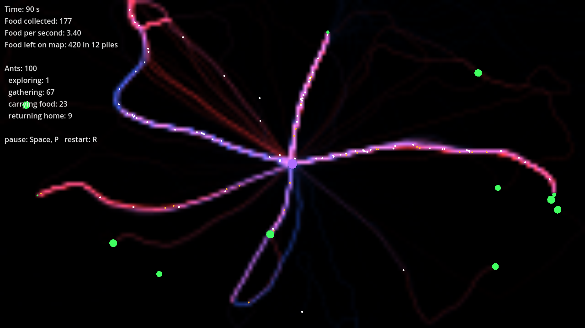

# ant-claude-test — Godot prototype

A video game prototype made with **Godot 4.3+** (standard version, not .NET).

## Run it
1. Get the code (first time): `git clone https://github.com/GaryNiet/ant-claude-test.git`
   Later updates: `git pull`
2. Open Godot → **Import** → select `project.godot` in this folder.
3. Press **F5** (Run). **Space** pauses, **R** restarts with a new random map.

## What you see
An ant colony simulation. Purple dot = nest, white dots = ants, orange dots = ants carrying
food, green dots = food piles (bigger = more food). Blue glow = "going out" pheromone,
red glow = "going home" pheromone (pink where both overlap). Stats are in the top-left corner.

## Where things are
| File | What it is |
|------|------------|
| `game_settings.cfg` | **All tunable values** (speeds, sizes, colors, keys, window). Edit this to tweak the game. |
| `REQUEST_LOG.md` | Dated log of every request and the commits that implemented it. |
| `scripts/simulation/` | The simulation itself (no drawing): `colony_simulation.gd` runs it, `ant.gd` is the ant brain, `pheromone_grid.gd` the map of smells. |
| `scripts/view/` | Drawing the simulation and the stats text. |
| `scenes/` | Godot scenes. |
| `CLAUDE.md` | Rules the AI assistant follows when changing this project. |
